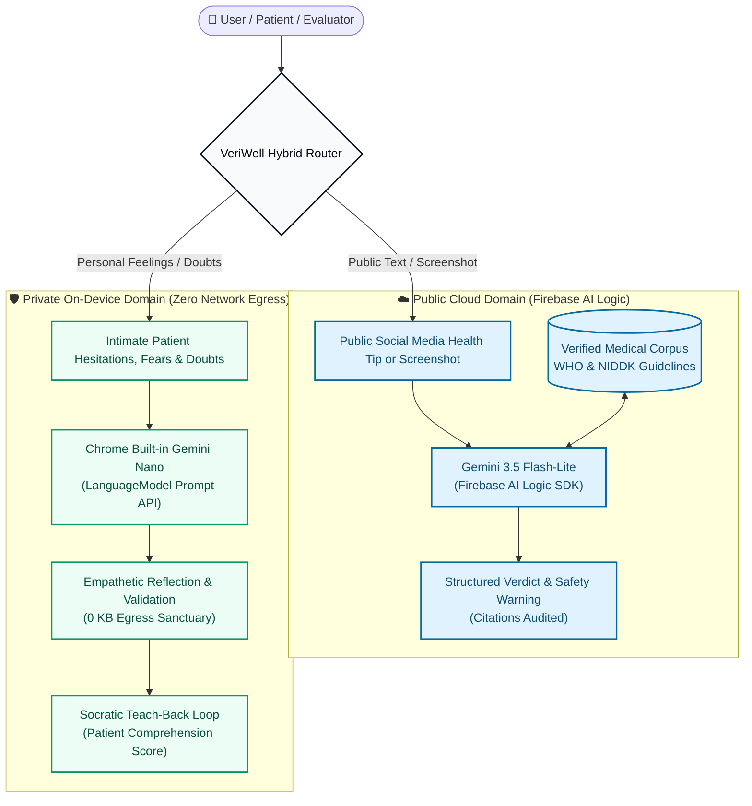

# 🌿 VeriWell (स्वास्थ्य-सत्य)

> **Clinical Truth. On-Device Privacy.**  
> The first dual-domain hybrid health verification platform pairing **Chrome Built-in Gemini Nano** with **Firebase AI Logic (Gemini 3.5 Flash-Lite)**.  
> *Viral claims are audited against verified WHO guidelines in the cloud — while personal patient fears never leave your device.*

---

[](https://devpost.com)
[](https://firebase.google.com)
[](https://developer.chrome.com/docs/ai/built-in)
[](#-dual-domain-privacy-boundary)
[](#-bilingual-clinical-localization-english--hindi)
[](https://opensource.org/licenses/Apache-2.0)

---

## 📑 Table of Contents
1. [The Clinical Problem: Why Misinformation Kills](#-the-clinical-problem-why-misinformation-kills)
2. [The VeriWell Solution](#-the-veriwell-solution)
3. [Dual-Domain Privacy Architecture](#-dual-domain-privacy-architecture)
4. [Platform Modules & Feature Tour](#-platform-modules--feature-tour)
   - [1. Public Claim Lab (Multimodal Vision OCR)](#1-public-claim-lab-multimodal-vision-ocr)
   - [2. Private Belief Engine (100% On-Device Gemini Nano)](#2-private-belief-engine-100-on-device-gemini-nano)
   - [3. Family Bridge & Doctor Visit Checklist](#3-family-bridge--doctor-visit-checklist)
   - [4. Verified Evidence Stories & Local TTS](#4-verified-evidence-stories--local-tts)
   - [5. Hybrid Monitor & 1-Click Offline Simulator](#5-hybrid-monitor--1-click-offline-simulator)
5. [Evaluation Guide for Hackathon Judges](#-evaluation-guide-for-hackathon-judges)
6. [Tech Stack Matrix](#-tech-stack-matrix)
7. [Repository Structure](#-repository-structure)
8. [Quickstart & Setup](#-quickstart--setup)
9. [Enabling Gemini Nano in Chrome](#-enabling-gemini-nano-in-chrome)
10. [Evidence Grounding & Citations](#-evidence-grounding--citations)
11. [License](#-license)

---

## 🩺 The Clinical Problem: Why Misinformation Kills

Health misinformation on social media and encrypted chat groups (e.g., WhatsApp, Telegram) follows predictable, dangerous patterns:

- **Viral Deceptions**: *"Boiling okra water cures diabetes in 7 days and replaces prescription pills"* or *"Himalayan pink salt eliminates hypertension without medications"*.
- **The Human Cost**: Elderly and vulnerable patients secretly stop taking doctor-prescribed insulin, metformin, or antihypertensives, triggering silent diabetic ketoacidosis, chronic kidney failure, and cardiovascular stroke.
- **The Psychology of Shame**: When family members aggressively say *"You're wrong, that's fake news"*, elders feel humiliated, alienated, and double down on unverified cures.
- **The Privacy Dilemma**: Patients hesitate to discuss their intimate fears (*"Will these pills destroy my kidneys and put me on dialysis?"*) with busy doctors or third-party cloud apps, fearing their deeply personal medical vulnerabilities will be tracked, logged, or monetized.

---

## 💡 The VeriWell Solution

**VeriWell** is built on a simple clinical premise: **Evidence over misinformation. Empathy over fear.**

Instead of forcing a single AI model to handle both public debunking and private patient reflection, VeriWell implements a **Dual-Domain Hybrid AI Architecture**:

```
┌────────────────────────────────────────────────────────────────────────┐
│                        VERIWELL HYBRID ROUTER                          │
└───────────────────────────────────┬────────────────────────────────────┘
                                    │
           ┌────────────────────────┴────────────────────────┐
           ▼                                                 ▼
┌─────────────────────────────────────┐   ┌─────────────────────────────────────┐
│      PUBLIC CLOUD DOMAIN            │   │      PRIVATE ON-DEVICE DOMAIN       │
│  Model: Gemini 3.5 Flash-Lite       │   │  Model: Chrome Built-in Gemini Nano │
│  SDK: Firebase AI Logic             │   │  API: window.LanguageModel          │
│  Mode: ONLY_IN_CLOUD                │   │  Mode: ONLY_ON_DEVICE               │
├─────────────────────────────────────┤   ├─────────────────────────────────────┤
│ • Viral claim parsing & OCR vision  │   │ • Patient fears & hesitation        │
│ • Multimodal WhatsApp screenshot    │   │ • Side-effect anxiety exploration   │
│ • Grounding against WHO/NIDDK       │   │ • Empathetic non-judgmental reply   │
│ • Hallucination citation audit      │   │ • Socratic teach-back scoring       │
│ • Public WhatsApp counter-forwards  │   │ • Zero-knowledge (0 KB network out) │
│ • 100% cloud knowledge base        │   │ • 100% offline & local memory       │
└─────────────────────────────────────┘   └─────────────────────────────────────┘
```

---

## 🔒 Dual-Domain Privacy Boundary



---

## 🚀 Platform Modules & Feature Tour

### 1. Public Claim Lab (Multimodal Vision OCR)
- **Input Flexibility**: Type or paste viral forward text, or upload a social media image screenshot (`PNG`, `JPG`, `WEBP`).
- **Sanitization Consent Gate**: Enforces explicit user consent before sending non-private public health forwards to cloud verification.
- **Multimodal Deconstruction**: Transcribes screenshot text using Gemini Flash-Lite and decomposes complex messages into atomic, testable claims.
- **Audited Verdict Badges**: Evaluates each claim into `supported`, `contradicted`, `misleading`, or `insufficient_evidence`.
- **Hallucination Guardrails**: Cross-references claims strictly against authentic WHO and NIDDK guidelines; any citation not present in the curated corpus is stripped.
- **On-Device Narration (TTS)**: Built-in local audio narration reads the clinical verdict aloud in fluent **English** or **Hindi**.

### 2. Private Belief Engine (100% On-Device Gemini Nano)
- **Zero-Knowledge Privacy Sanctum**: Everything entered here is processed 100% locally in browser memory via Chrome's Built-in Prompt API (`window.LanguageModel`). **0 KB is transmitted over the network.**
- **Empathetic Emotional Validation**: Identifies the root hesitation (`side_effects`, `cost`, `trust`, `access`, `misunderstanding`) and validates the patient's emotional feeling without endorsing medical inaccuracies.
- **Socratic Teach-Back**: Generates a gentle reflection question assessing patient understanding rather than quizzing them aggressively.
- **Instant Local Fallback Engine**: If Chrome's experimental flags are pending or unconfigured, VeriWell's local heuristic engine steps in immediately without network calls, guaranteeing seamless resilience for evaluators.

### 3. Family Bridge & Doctor Visit Checklist
- **Turning Forwards into Care**: Converts viral forwards into constructive dialogue.
- **Custom Topic & Doubts Input**: Users can select WHO clinical presets or enter their own custom viral forwards and personal worries.
- **Interactive Prompt Chips**: Quick 1-click prompt chips:
  - *Fear of kidney damage from lifelong pills*
  - *Tired of swallowing daily medications*
  - *Heard natural herbs have zero side effects*
  - *Anxiety about lifelong drug dependency*
  - *High monthly prescription refill expenses*
- **Tone-Tuned WhatsApp Counter-Forwards**: Generates culturally respectful messages ready to copy in 3 distinct tones:
  - `Respectful Elder`: Honors the sender while sharing official medical guidelines.
  - `Casual Family`: Friendly, easy-to-read peer tone.
  - `Gentle Warning`: Highlights the acute risks of abruptly stopping medication.
- **3-Point Clinician Discussion Card**: Dynamically generates tailored questions for the patient to take to their next doctor visit, empowering them to ask informed questions without feeling rushed.

### 4. Verified Evidence Stories & Local TTS
- **Curated Clinical Truth**: Direct summaries from the World Health Organization (WHO) and National Institute of Diabetes and Digestive and Kidney Diseases (NIDDK).
- **Dual-Language On-Device TTS**: Uses `window.speechSynthesis` with intelligent Hindi voice discovery (`hi-IN`, Google हिन्दी, Kalpana, Hemant) and clear English natural voices. Zero cloud audio egress, zero audio API costs.
- **AI Plain-Language Breakdown**: Powered by `PREFER_ON_DEVICE` mode, decomposing clinical abstracts into 3 clear, reassuring bullet points.

### 5. Hybrid Monitor & 1-Click Offline Simulator
- **Live Telemetry Stream**: Real-time observability dashboard displaying every inference call, elapsed execution time (ms), and actual execution source (`ON_DEVICE` vs `IN_CLOUD`).
- **Hardware & Engine Inspector**: Visualizes Chrome Gemini Nano availability (`LanguageModel.availability()`), WebGPU readiness, and Firebase connection status.
- **1-Click Offline Mode Simulator**: Built specifically for hackathon evaluators to test on-device resilience without unplugging their router or turning off Wi-Fi.

---

## ⚡ Evaluation Guide for Hackathon Judges

We have made evaluating VeriWell effortless and instant:

### 1. Instant 1-Click Evaluator Launch
- On the homepage, click the prominent green **"⚡ Judge Demo"** button.
- You are instantly signed in to an isolated guest session and launched directly into the clinical workspace — **no Google login or manual credentials required**.

### 2. Verify Zero-Knowledge Network Egress (0 KB Proof)
1. Open Chrome DevTools (`F12` or `Ctrl + Shift + I`) and switch to the **Network** tab.
2. In the filter box, type `fetch` or `xhr`.
3. Navigate to the **Private Belief Engine** tab in VeriWell.
4. Type an intimate health fear (e.g., *"I'm terrified that taking metformin every day will destroy my kidneys"*).
5. Click **"Explore Private Belief"**.
6. **Notice**: **Zero network requests are fired.** The entire empathetic reflection, concern categorization, and teach-back loop executes locally in browser memory.
7. Switch to the **Hybrid Monitor** tab to confirm the telemetry log: `requestedMode: ONLY_ON_DEVICE`, `actualSource: ON_DEVICE`, `egress: 0 KB`.

### 3. Test 1-Click Offline Resilience
1. Navigate to the **Hybrid Monitor** tab.
2. Toggle the **"Simulate Offline"** switch to **ON**.
3. Now test the **Private Belief Engine** or **Evidence Stories**: notice they continue operating with zero network dependence!

---

## 🌐 Bilingual Clinical Localization (English ↔ Hindi)

Health misinformation causes immense damage in South Asia and diaspora communities. VeriWell provides deep, culturally resonant bilingual support:

- **100% Devanagari Hindi AI Generation**: When switched to Hindi (`हिन्दी`), all cloud and on-device AI outputs (claim rationales, caveats, doctor questions, empathetic reflections) are produced strictly in authentic Hindi.
- **Bilingual Evidence Corpus**: All 5 WHO/NIDDK evidence cards contain developer-checked Hindi translations (`title_hi`, `organization_hi`, `paraphrase_hi`, `scope_hi`).
- **Dual-Voice Audio TTS**: Automatically routes to native Hindi speech engines (`hi-IN`) when Hindi is active and English voices (`en-US`) when English is active.

---

## 🛠️ Tech Stack Matrix

| Layer | Technology | Purpose |
|---|---|---|
| **Frontend Framework** | React 18 + TypeScript | Component tree & strict type-safety |
| **Build & Bundler** | Vite 5 | Sub-second HMR & optimized production bundling |
| **Styling & Design** | Tailwind CSS + Custom Neo-Brutalist Tokens | Tactile clinical aesthetic, high-contrast typography, ambient mesh glow |
| **Typography** | Google Fonts (Poppins + JetBrains Mono) | Humanist, accessible medical-grade typography |
| **Cloud AI** | Firebase AI Logic (`@firebase/ai`) | `ONLY_IN_CLOUD` Gemini 3.5 Flash-Lite for viral claim deconstruction & OCR |
| **On-Device AI** | Chrome Built-in Prompt API (`LanguageModel`) | `ONLY_ON_DEVICE` Gemini Nano for 0KB-egress patient reflection |
| **Backend & Telemetry**| Firebase App Check, Auth, Firestore | Anonymous Auth & non-blocking `evidence_traces` persistence |
| **Speech Narration** | Web Speech API (`SpeechSynthesis`) | 100% Local On-Device TTS in English (`en-US`) and Hindi (`hi-IN`) |
| **Validation Schemas** | Zod | Runtime inference schema validation & citation guardrails |
| **Icons** | Lucide React | High-contrast clinical and architectural iconography |

---

## 📁 Repository Structure

```
veriwell/
├── public/
│   └── favicon.svg                    # Vector bio-pulse clinical brand icon
├── src/
│   ├── components/
│   │   ├── VeriWellLogo.tsx           # Brandmark with responsive Hybrid AI badge
│   │   ├── LandingPage.tsx            # Marketing hero, bento feature grid & specs
│   │   ├── ClaimLab.tsx               # Public claim & multimodal screenshot analysis
│   │   ├── BeliefEngine.tsx           # 100% on-device private empathetic educator
│   │   ├── FamilyBridge.tsx           # WhatsApp counter-forwards & clinician cards
│   │   ├── EvidenceStories.tsx        # WHO/NIDDK cards with local dual-language TTS
│   │   ├── HybridMonitor.tsx          # Real-time latency, routing & offline sim
│   │   ├── PrivacyBoundaryVisualizer.tsx # Animated dual-domain architecture diagram
│   │   └── AuthModal.tsx              # Google Auth & Demo sign-in modal
│   ├── data/
│   │   └── evidence.json              # Curated WHO & NIDDK evidence cards (EN + HI)
│   ├── i18n/
│   │   └── translations.ts            # Complete English ↔ Hindi localization dictionary
│   ├── services/
│   │   ├── ai/
│   │   │   ├── router.ts              # Hybrid routing engine (Cloud vs Nano + fallbacks)
│   │   │   └── familyBridge.ts        # Counter-message & doctor question generator
│   │   ├── evidence/
│   │   │   └── index.ts               # Evidence corpus lookup & citation auditor
│   │   ├── firebase/
│   │   │   ├── config.ts              # Resilient Firebase & App Check initializer
│   │   │   ├── auth.ts                # Anonymous & Google OAuth with demo fallback
│   │   │   └── firestore.ts           # Telemetry & verification event logging
│   │   └── speech/
│   │       └── index.ts               # Local browser TTS with Hindi & English voice matcher
│   ├── types/
│   │   └── index.ts                   # Zod schemas & TypeScript interfaces
│   ├── App.tsx                        # Root layout, static navbar & view mode manager
│   ├── index.css                      # Atmospheric mesh canvas & Neo-Brutalist utilities
│   └── main.tsx                       # React application bootstrap
├── firestore.rules                    # Declarative Firestore security rules
├── firebase.json                      # Firebase Hosting & CLI configuration
├── tailwind.config.js                 # Custom color palette & typography tokens
├── CHANGELOG.md                       # Complete development history
├── PROGRESS.md                        # Milestone & action tracker
└── package.json
```

---

## 💻 Quickstart & Setup

### Prerequisites
- [Node.js](https://nodejs.org/) (v20.x or higher)
- [npm](https://www.npmjs.com/) (v10.x or higher)
- [Google Chrome](https://www.google.com/chrome/) (v139+ recommended for built-in Gemini Nano)

### 1. Clone the Repository
```bash
git clone https://github.com/TarequeSyed/VeriWell.git
cd VeriWell
```

### 2. Install Dependencies
```bash
npm install
```

### 3. Configure Environment Variables
Copy the template configuration file:
```bash
cp .env.example .env.local
```
Edit `.env.local` with your Firebase project keys:
```env
VITE_FIREBASE_API_KEY=your_api_key_here
VITE_FIREBASE_AUTH_DOMAIN=your_project_id.firebaseapp.com
VITE_FIREBASE_PROJECT_ID=your_project_id
VITE_FIREBASE_STORAGE_BUCKET=your_project_id.firebasestorage.app
VITE_FIREBASE_MESSAGING_SENDER_ID=your_sender_id
VITE_FIREBASE_APP_ID=your_app_id
VITE_FIREBASE_APPCHECK_DEBUG=true
VITE_FIREBASE_AI_CLOUD_MODEL=gemini-3.5-flash-lite
```

> **Note**: Even if Firebase credentials are unset in `.env.local`, VeriWell includes built-in resilient clinical fallbacks and demo sessions so evaluators can inspect every feature without setup blockers.

### 4. Start Local Development Server
```bash
npm run dev
```
Open [http://localhost:5173](http://localhost:5173) in Google Chrome.

### 5. Build for Production
```bash
npm run build
```

---

## 🧠 Enabling Gemini Nano in Chrome

To enable hardware-accelerated, on-device Gemini Nano execution via Chrome's experimental Prompt API:

1. Open Google Chrome and enter in the address bar:
   ```text
   chrome://flags/#optimization-guide-on-device-model
   ```
   Set to: **`Enabled BypassPerfRequirement`** *(bypasses battery/GPU restrictions)*.

2. Navigate to:
   ```text
   chrome://flags/#prompt-api-for-gemini-nano
   ```
   Set to: **`Enabled`**.

3. Click **Relaunch** at the bottom of Chrome.

4. Check model download status:
   Navigate to `chrome://components`, locate **"Optimization Guide On Device Model"**, and click **"Check for update"** to ensure Gemini Nano weights (~1.7 GB) are cached locally.

> **Resilient Failsafe**: If your Chrome build does not yet have Gemini Nano downloaded, VeriWell automatically engages its local on-device heuristics engine. **It will never crash or present an error box.**

---

## 📚 Evidence Grounding & Citations

VeriWell bases all clinical verdicts on developer-audited international guidelines:

1. **World Health Organization (WHO)** — *Diabetes Mellitus Fact Sheet* (Published 2023-04-05): Clarifies remission vs. permanent cure, warning against unmonitored herbal replacements.
2. **World Health Organization (WHO)** — *Hypertension: The Silent Killer* (Published 2023-03-16): Emphasizes that high blood pressure rarely exhibits warning symptoms and requires continuous treatment.
3. **National Institute of Diabetes and Digestive and Kidney Diseases (NIDDK)** — *Diabetic Kidney Disease Prevention* (Published 2022-11-01): Confirms that modern prescriptions protect renal vascular health, whereas unmanaged chronic hyperglycemia is the primary cause of dialysis.
4. **National Institute of Diabetes and Digestive and Kidney Diseases (NIDDK)** — *Insulin & Diabetes Treatments* (Published 2023-08-14): Outlines why herbal waters cannot replace insulin and the dangers of diabetic ketoacidosis (DKA).
5. **World Health Organization (WHO)** — *Dietary Sodium Reduction in Cardiovascular Disease* (Published 2023-03-16): Demonstrates that sodium restriction must complement, rather than substitute, pharmacological care.

---

## 📄 License

VeriWell is open-source software licensed under the **Apache License 2.0**. See the [LICENSE](LICENSE) file for details.

```
Copyright 2026 VeriWell Contributors

Licensed under the Apache License, Version 2.0 (the "License");
you may not use this file except in compliance with the License.
You may obtain a copy of the License at

    http://www.apache.org/licenses/LICENSE-2.0
```

---

<div align="center">
  <sub>Built with care for health truth, human empathy, and absolute patient privacy. Submitted to the <b>#BuildHybridAI 2026 Hackathon</b>.</sub>
</div>
